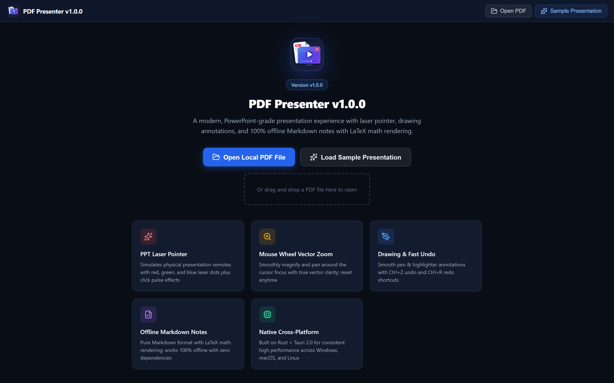
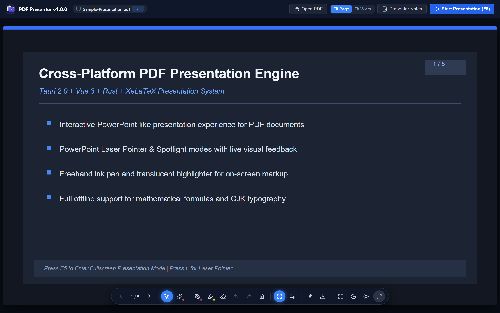
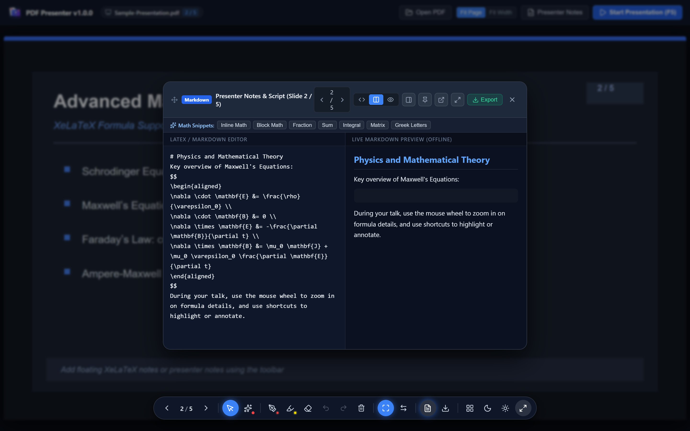
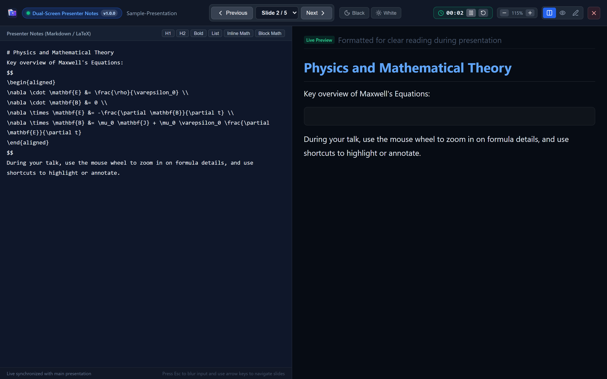

#  PDF Presenter

**PDF Presenter** turns any standard PDF document into a smooth, PowerPoint-like presentation on your desktop. It provides distraction-free fullscreen playback, a glowing laser pointer, mouse-wheel zoom, freehand pen and highlighter annotations, and built-in offline presenter notes with Markdown and math formula support—all in a lightweight native app.

## Screenshots

### Welcome & Quick Start


### Slide Presentation & Live Annotations


### Presenter Notes with Math Support


### Dual-Screen Presenter View & Timer


## Installation & Usage on PC

Currently, **PDF Presenter** is installed by building from source. Once built, open the application on your PC, drag and drop any `.pdf` file into the window (or click **Open PDF**), and press **`F5`** to start presenting in fullscreen. While presenting, use the arrow keys or `Space` to flip slides, scroll the mouse wheel to zoom in on details, press **`L`** for the laser pointer, **`D`** / **`H`** to draw or highlight (`Ctrl+Z` to undo), and **`N`** to open or pop out your presenter notes onto a second monitor.

```bash
# 1. Clone the repository
git clone https://github.com/stephen359595/pdf-presenter.git
cd pdf-presenter

# 2. Install dependencies (requires Node.js, pnpm, and Rust/Cargo)
pnpm install

# 3. Run directly on your PC in development mode
pnpm tauri dev

# 4. Or build standalone portable executable + native installer (NSIS on Windows)
pnpm tauri build
```

## How to Contribute

Contributions of all kinds—bug reports, feature suggestions, UI improvements, and documentation updates—are welcome!

1. **Fork & Clone**: Fork this repository and clone it to your local machine.
2. **Create a Branch**: Create a feature or bugfix branch for your changes.
3. **Make & Test Changes**: Ensure the application builds cleanly (`pnpm build`) and passes all unit tests (`pnpm test`).
4. **Submit a Pull Request**: Open a Pull Request with a clear description of what you changed and why.

## Code of Conduct

We are committed to providing a friendly, safe, and welcoming environment for everyone. By participating in this project, you agree to abide by the following standards:

- **Be Respectful**: Treat all contributors, users, and maintainers with respect and consideration. Constructive criticism is welcome, but personal attacks, harassment, or demeaning behavior will not be tolerated.
- **Be Inclusive**: Welcome newcomers and support people of all backgrounds, skill levels, and perspectives.
- **Focus on Collaboration**: Keep discussions focused on improving the project and helping the community.

Unacceptable behavior may result in removal from project discussions or repositories at the maintainers' discretion.
